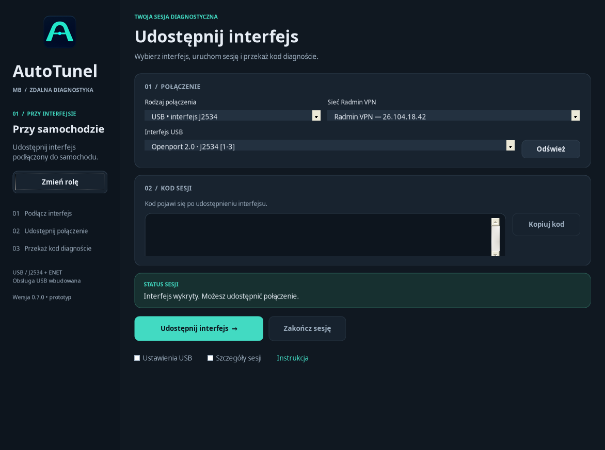

# AutoTunel MB 0.7.0 — jeden EXE, nowy wygląd

**[Pobierz AutoTunel.exe](downloads/AutoTunel.exe?raw=true)**

Ten sam plik uruchamiasz na obu komputerach. Wybierz rolę **Przy samochodzie**
lub **Diagnosta**. Pakiety USB, ikona i instrukcja są wewnątrz EXE; nie trzeba
kopiować dodatkowych DLL, ikon ani plików konfiguracyjnych obok programu.

Nowości: grafitowy motyw z turkusowymi akcentami, czytelniejsze karty i statusy,
nowy wybór roli oraz ikona w oknach, pasku zadań i Eksploratorze Windows.
Ikona jest osadzona w siedmiu rozmiarach od 16 do 256 pikseli.

Podgląd rzeczywistego interfejsu uruchomionego przez Mono na Linux,
z przykładowymi danymi. Nie jest to próba sprzętowa Openporta.

Obsługa USB/IP jest przygotowywana automatycznie z EXE. U diagnosty pierwsza
instalacja wymaga restartu; program pokazuje komunikat i nie restartuje
komputera samodzielnie. Wymagane: Windows 10 (od 1903)/11 x64, .NET Framework 4.8,
administrator, RadminVPN i sterownik używanego interfejsu. ENET nadal wymaga Npcap/TAP.

Kompilacja: 0 ostrzeżeń i 0 błędów; **42 testy PASS**, kontrola obu pakietów USB,
wszystkich zasobów i natywnej ikony EXE. Sprawdzono też podgląd obu ról,
mniejsze okno i ograniczanie rozmiaru do obszaru ekranu.
[Raport testów](TESTY.txt). Instalacja sterowników i działanie ze sprzętem
wymagają jeszcze [próby na Windows](WINDOWS-TEST.md).

[Pełna paczka ze źródłami i licencjami](downloads/AutoTunel-MB-0.7.0.zip?raw=true)
• [Sumy SHA-256](downloads/SHA256SUMS.txt)

Oficjalny instalator usbipd-win tworzy standardową regułę zapory; program nie
włącza ani nie wyłącza zapory. Bez zapory port 3240 może być dostępny poza
kodem i TLS AutoTunel. Korzystaj z zaufanej sieci. EXE prototypu nie ma podpisu wydawcy.

Repozytorium jest prywatne. Jeśli GitHub pokazuje 404, zaloguj się na konto
z dostępem. Na stronie pliku wybierz **Download raw file** lub **View raw**.
