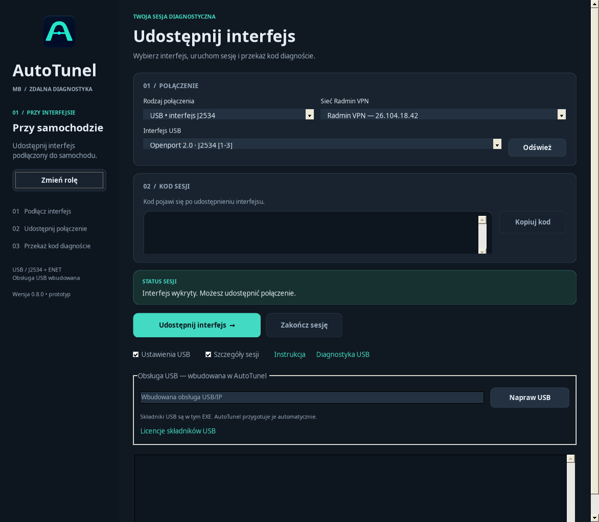

# AutoTunel MB 0.8.0 — naprawa instalacji USB

**[Pobierz AutoTunel.exe](downloads/AutoTunel.exe?raw=true)**

Na komputerze przy samochodzie zamknij poprzedni AutoTunel, uruchom nowy EXE
i wybierz **Przy samochodzie → Ustawienia USB → Napraw USB**.

Wersja 0.8 poprawia wybór faktycznie zainstalowanego USB/IP, błędy ponownej
instalacji i obsługę restartu. Ścieżka z zarejestrowanej instalacji ma
pierwszeństwo przed dawnym ustawieniem wskazującym starszy plik.
Błąd wersji pokazuje wersję wykrytą oraz wymaganą.

Pakiet serwera usbipd-win 5.3.0 oficjalnie obsługuje Windows 10 1809/build 17763,
w tym LTSC 2019. Klient/Diagnosta nadal wymaga Windows 10 1903/build 18362.
Program sprawdza rzeczywisty system i natywne x64 przed przygotowaniem USB.

Naprawa odtwarza zgodną rejestrację MSI i sterowniki; rozpoznana starsza
instalacja może zostać jawnie zaktualizowana do wersji wbudowanej.
Aktywne sesje, maszyny VirtualBox, własny zapis odzyskiwania, nowsza lub
nierozpoznana wersja blokują tę operację. Jeśli działa starsza usługa lub
brakuje jej narzędzia, program poprosi o zakończenie sesji i zatrzymanie
USBIP Device Host w Usługach Windows.

**Diagnostyka USB** w dolnym pasku otwiera trwałe dzienniki Windows/wersji,
wyjątków i kodów instalatora oraz kopię dziennika MSI i fragment SetupAPI.
Jeśli problem się powtórzy, zachowaj `usb-server-last.log`, `usb-server-msi-last.log`
i `usb-server-setupapi-last.log` z otwartego folderu. Nie dołączaj kodu sesji.

Zwykły błąd zakończonego instalatora nie zamienia się już w fikcyjne żądanie
restartu. Prawdziwy wymagany restart i niepotwierdzony działający instalator
nadal są chronione. Po zapisie restartu pozostawionym przez 0.7 może być
potrzebne jedno ponowne uruchomienie Windows. Program nie restartuje sam.

Podgląd Mono/Linux z przykładowymi danymi. To nie jest test sterowników Windows.

Kompilacja: **0 ostrzeżeń, 0 błędów, 50 testów PASS**. Sprawdzono zasoby EXE,
oryginalne sumy pakietów USB i siedem rozmiarów ikony.
[Raport](TESTY.txt) • [Procedura Windows/LTSC](WINDOWS-TEST.md)

Nie potwierdzono instalacji na komputerze użytkownika ani dokładnej przyczyny
błędu sterownika. Oficjalnych pakietów i podpisów nie zmieniano. Nie jest
wyłączana kontrola podpisów. Nadal wymagane są .NET Framework 4.8, RadminVPN,
administrator i sterownik interfejsu. ENET wymaga Npcap/TAP jak wcześniej.

[Pełna paczka ze źródłami i licencjami](downloads/AutoTunel-MB-0.8.0.zip?raw=true)
• [Sumy SHA-256](downloads/SHA256SUMS.txt)

Repozytorium jest prywatne. W razie 404 zaloguj się na konto mające dostęp.
Na stronie pliku wybierz **Download raw file** lub **View raw**.
